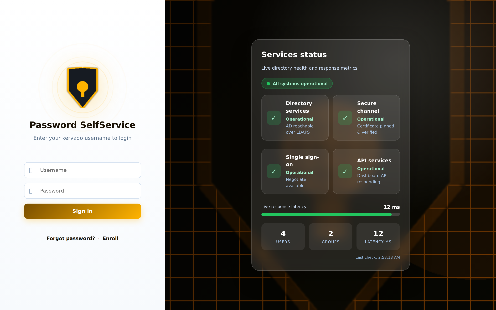
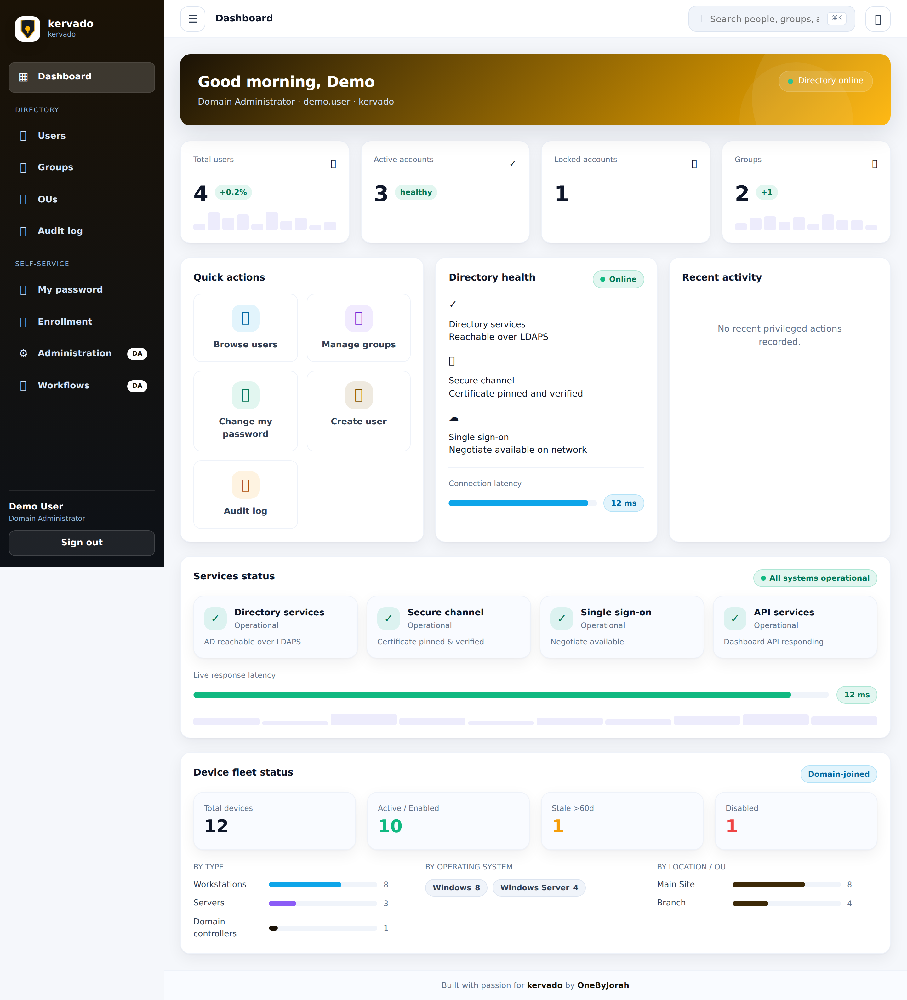
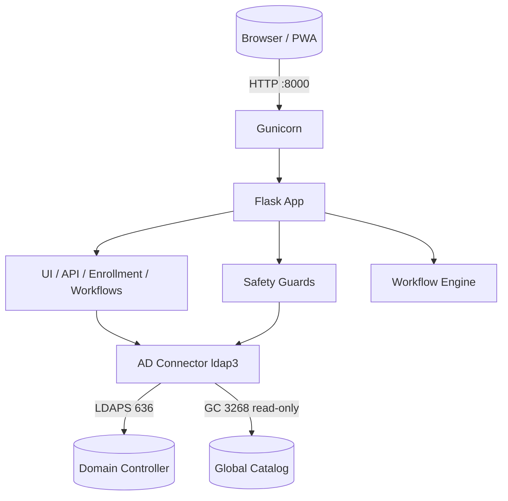
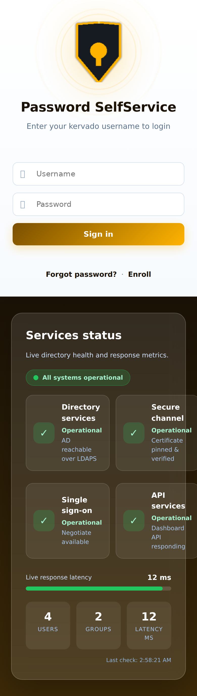
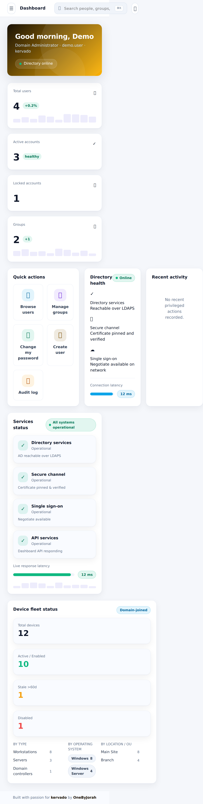

<div align="center">


# kervado

<small>Formerly AegisPass</small>

**A self-service Active Directory password reset portal for Windows domain users — LDAPS-pinned, workflow-driven, and fully audited.**

<a href="https://github.com/OneByJorah/kervado/stargazers"></a>
<a href="https://github.com/OneByJorah/kervado/commits"></a>


</div>

| Login portal | Admin dashboard |
|---|---|
|  |  |

## Why this exists

kervado gives end users a secure self-service way to reset expired or forgotten Active Directory passwords and unlock accounts, while giving helpdesks a safe admin UI for user lifecycle actions. It connects to the domain controller over **LDAPS with SHA-256 certificate fingerprint pinning** (fail-closed), keeps a **read-only Global Catalog** connection for cross-domain lookups, and records every privileged action to an audit trail.

The current Flask application consolidates the earlier PyPass and AD-Passreset-Portal tools, retained under `legacy/` for reference.

## Quick start

The fastest way to see kervado is in **demo mode**. Demo mode uses an in-memory synthetic directory, so no real AD is required and no credentials leave your machine.

```bash
git clone https://github.com/OneByJorah/kervado.git && cd kervado
cp .env.example .env
# Enable the built-in demo directory
sed -i 's/^DEMO_MODE=false/DEMO_MODE=true/' .env
docker compose up -d --build
```

Open **`http://127.0.0.1:8000/login`** and sign in with:

- Username: `demo.user`
- Password: `demo`

Health check: **`http://127.0.0.1:8000/health`**.

To stop:

```bash
docker compose down -v
```

> [!NOTE]
> On first run Docker may take a minute to download the Python base image and Playwright browser binaries (if you capture screenshots locally).

## Features

- **Self-service password reset** — users reset expired or forgotten passwords from the portal; expiry reminders fire through the workflow engine at configurable day thresholds.
- **Account unlock & lifecycle** — create, update, disable/enable, unlock, and delete users, plus force-change-at-next-logon.
- **Tier-0 safety guards** — changes to Domain Admins, Enterprise Admins, Schema Admins, and KRBTGT are blocked or gated, preventing catastrophic misconfiguration.
- **Hardened LDAP management channel** — LDAPS on port 636 with `AD_CERT_FINGERPRINT` pinning; connections to a mismatched DC are refused.
- **Read-only Global Catalog** — forest-wide searches on port 3268, never used for writes.
- **SSO / Kerberos** — GSSAPI/Negotiate login for domain-joined machines, with username/password fallback for the rest.
- **Self-service enrollment** — recovery profile plus TOTP MFA enrollment via any authenticator app.
- **Audit trail** — every reset, enrollment, and workflow action logged with user, timestamp, source IP, and result.
- **Demo / mock mode** — run the full UI with synthetic data for screenshots, CI, and local evaluation without a live directory.

## Architecture



### Project layout

```text
kervado/
├── app/
│   ├── ad/            # AD connector, safety guards, health (ldap3)
│   ├── auth/          # LDAP bind + Kerberos/GSSAPI SSO
│   ├── routes/        # ui, api, enrollment, workflows blueprints
│   ├── static/        # PWA assets, CSS, JS
│   └── templates/     # base.html, auth/login.html
├── config/workflows.json
├── deploy/            # nginx config, install script
├── docker-compose.yml
├── Dockerfile         # python:3.11-slim + gunicorn
├── legacy/            # PyPass + AD-Passreset-Portal (reference)
└── systemd/kervado.service
```

## Configuration

Copy `.env.example` to `.env`. The most important variables:

### Demo / mock mode

| Variable | Default | Description |
|---|---|---|
| `DEMO_MODE` | `false` | Run with synthetic AD data; no real directory required. |
| `DEMO_USERNAME` | `demo.user` | Demo account username. |
| `DEMO_PASSWORD` | `demo` | Demo account password. |

### Active Directory (writable, LDAPS)

| Variable | Default | Description |
|---|---|---|
| `AD_HOST` | — | Domain controller hostname or IP |
| `AD_LDAPS_PORT` | `636` | LDAPS port |
| `AD_DOMAIN` | — | AD domain (e.g. `example.com`) |
| `AD_BASE_DN` | — | Base DN for searches (e.g. `DC=example,DC=com`) |
| `AD_BIND_USER` | — | Service account DN for write operations |
| `AD_BIND_PASSWORD` | — | Service account password |
| `AD_CERT_FINGERPRINT` | — | Pinned SHA-256 certificate fingerprint (fail-closed) |

### Global Catalog (read-only)

| Variable | Default | Description |
|---|---|---|
| `AD_GC_HOST` | — | Global Catalog server hostname |
| `AD_GC_PORT` | `3268` | Global Catalog LDAP port |

### Application

| Variable | Default | Description |
|---|---|---|
| `SECRET_KEY_FLASK` | — | Flask session secret key |
| `SESSION_LIFETIME_MINUTES` | `30` | Session lifetime |
| `DEBUG` | `False` | Enable debug mode |
| `COMPANY` / `APP_NAME` | `kervado` | Display branding |
| `EXPIRY_REMINDER_DAYS` | `7,3` | Comma-separated password-expiry reminder thresholds |
| `SSO_ENABLED` | `true` | Enable Kerberos/Negotiate SSO detection |

### Integrations

| Variable | Default | Description |
|---|---|---|
| `SMTP_ENABLED` / `SMTP_HOST` / `SMTP_PORT` | `False` / — / `25` | Internal SMTP relay settings |
| `SMS_PROVIDER` | `none` | `none`, `mock`, `gammu`, or `twilio` |
| `SMS_GATEWAY_URL` / `SMS_API_TOKEN` | — | Self-hosted Gammu REST gateway |
| `SLACK_BOT_TOKEN` / `SLACK_ACTIVATION` | — / `False` | Slack notifications |
| `RECAPTCHA_ENABLED` / `RECAPTCHA_PUBLIC_KEY` / `RECAPTCHA_PRIVATE_KEY` | `False` / — / — | Login CAPTCHA |

> [!NOTE]
> Production deployments require at minimum `SECRET_KEY_FLASK`, `AD_HOST`, `AD_BASE_DN`, `AD_BIND_USER`, `AD_BIND_PASSWORD`, and a valid `AD_CERT_FINGERPRINT`. Set `DEMO_MODE=false` to use your real directory.

## API

The REST API is mounted under `/api` and covered by `app/routes/api.py`:

| Method | Endpoint | Purpose |
|---|---|---|
| GET | `/api/user-stats`, `/api/device-stats` | Dashboard counts |
| GET/POST | `/api/users` | List / create users |
| GET/PATCH/DELETE | `/api/users/<dn>` | Read / update / delete a user |
| POST | `/api/users/<dn>/enable`, `/unlock` | Enable / unlock |
| POST | `/api/users/<dn>/password` | Administrative password set |
| POST | `/api/self/password`, `/self/reset-request`, `/self/reset-confirm` | Self-service flows |
| GET/POST/DELETE | `/api/groups`, `/api/groups/<dn>` | Group management |
| GET | `/api/audit` | Audit log |
| GET | `/health`, `/health/ldap`, `/status.json` | Health / status |

## Use cases

1. **Helpdesk deferral** — domain users self-reset passwords and unlock accounts without queueing a ticket.
2. **Compliance** — audit logging and Tier-0 guards make privileged changes reviewable and hard to misfire.
3. **MSP / enterprise AD** — one portal over a hardened LDAPS channel with pinned certificates, plus forest-wide GC lookups.

## Tech stack

Python 3.11, Flask 3.1, ldap3, pyotp, gunicorn, Docker / Docker Compose, nginx, systemd.

## Screenshots

Real screenshots captured from the local demo stack:

| Desktop login | Mobile login |
|---|---|
|  |  |

| Desktop dashboard | Mobile dashboard |
|---|---|
|  |  |

To regenerate them locally:

```bash
docker compose up -d --build
npm install --no-save playwright
npx playwright install chromium
node scripts/screenshots.mjs
```

## Security

- SHA-256 certificate fingerprint pinning on the LDAPS channel (fail-closed).
- Tier-0 objects protected by safety guards.
- Non-root container (`appuser`); non-sensitive login status panel that avoids leaking internal hostnames.
- Report vulnerabilities privately via [GitHub Security Advisories](https://github.com/OneByJorah/kervado/security/advisories/new).

## Contributing

Fork, branch, and open a pull request — see [CONTRIBUTING.md](CONTRIBUTING.md). [Open an issue](https://github.com/OneByJorah/kervado/issues) for bugs or ideas.

## License

MIT — see [LICENSE](LICENSE).

## Connect

- [jorahone.com](https://jorahone.com)
- [GitHub Org](https://github.com/OneByJorah)
